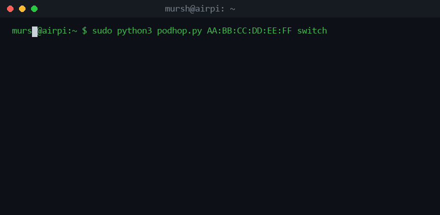

# podhop

<p align="center">
  
</p>

**AirPods quick-switching for Linux.** Pull your AirPods to your Linux machine
the moment you start using it — and let your iPhone or MacBook take them back
when you pick those up. Apple-style automatic switching, without Apple.

```console
$ podhop AA:BB:CC:DD:EE:FF switch
[*] paging AA:BB:CC:DD:EE:FF over L2CAP PSM 0x1001...
[+] AAP handshake OK
[+] host table received (323B) — session is live
[+] AirPods are on this host now
```

> **Status: v0.1 prototype.** The core takeover mechanic is proven working
> (Raspberry Pi Zero 2 W + AirPods Pro, tested against a MacBook and an
> iPhone on the same network of devices). It needs testing across more
> Bluetooth adapters, AirPods generations, and distros — that's what the
> Issues tab is for. See [Limitations](#limitations).

## How it works

Your AirPods speak a control protocol called **AAP** over Bluetooth L2CAP
(PSM `0x1001`). Any host that has paired with the AirPods can open that
channel and hold it — and the AirPods keep their ACL link on whichever host
is holding a live session.

`podhop` does exactly what an Apple device does when it wants your AirPods:

1. Opens an L2CAP channel to the AirPods on PSM `0x1001`
2. Performs the AAP handshake
3. Holds the session — your AirPods are now on this machine

Wire that to "local audio started playing" (PipeWire/PulseAudio) and you get
the Apple experience: sound starts on Linux → AirPods come over. Start using
your iPhone → its own auto-switching takes them back. No cloud, no iCloud,
nothing leaves your machines.

### The key extraction (optional, unlocks more)

The AirPods' switching cluster is keyed by a shared secret (**accKey**) that
Apple devices exchange via iCloud. We found the AirPods will happily serve it
to any *paired* host over the AAP channel. With it, `podhop` can decrypt the
AirPods' BLE proximity broadcasts — useful for ear detection and presence —
and it's the groundwork for fully AirPods-initiated switching.

```
$ podhop extract-keys AA:BB:CC:DD:EE:FF
accKey: a1b2c3d4e5f6...
```

Extraction talks only to your own paired AirPods over your own Bluetooth
link. Nothing contacts Apple. We tested whether this leaks without pairing:
it does **not** — the channel requires an authenticated link (see
[docs/PROTOCOL.md](docs/PROTOCOL.md)).

## How to use it

**Read [docs/USAGE.md](docs/USAGE.md)** — the practical guide: the mental model, the
physical rules (open case / in-ears, range, one owner at a time), what a
working switch looks like, daily-use flow, and a troubleshooting table.

## Requirements

- Linux with BlueZ ≥ 5.50
- AirPods paired to the machine (`bluetoothctl pair ...`)
- Python 3.9+
- Root or `CAP_NET_RAW` for some L2CAP operations (try without first)

## Quick start

```bash
# 1. Pair once, if you haven't:
bluetoothctl scan on          # find your AirPods' address
bluetoothctl pair XX:XX:XX:XX:XX:XX
bluetoothctl trust XX:XX:XX:XX:XX:XX

# 2. Pull them to this machine:
sudo python3 podhop.py XX:XX:XX:XX:XX:XX switch

# 3. Send them back / release the link:
sudo python3 podhop.py XX:XX:XX:XX:XX:XX release
```

The `switch` command holds the AAP channel open (default 300 s) so the
AirPods stay with you. On a machine with working audio, A2DP engages over
the same link and you're streaming.

## Roadmap

- [ ] **v0.2 — daemon mode**: PipeWire/PulseAudio watcher, auto-switch on
      playback start, release on stop, systemd user service
- [ ] **v0.3 — the extras**: battery status, ear detection (pause on remove),
      ANC control via AAP (building on LibrePods' protocol work)
- [ ] **v1.0 — installer + packaging**: pip package, Arch AUR, deb
- [ ] **research**: AirPods-initiated switching (see docs/PROTOCOL.md — we
      capture an as-yet-undocumented action message type `0x0A` during real
      switches)

## Limitations

- The case must be **open** (or buds in ears) for a takeover — closed-case AirPods ignore connection attempts. Same behavior as Apple's own devices, and irrelevant in daily use: you switch them while wearing them.
- Proven on **one configuration**: Raspberry Pi Zero 2 W (BlueZ 5.82,
  Debian 13) + AirPods Pro (firmware 9A348). Other adapters/AirPods models
  should work — AAP is model-independent per LibrePods — but are untested.
- Headless machines with no audio server still hold the link via the AAP
  session; playback machines get A2DP automatically.
- AirPods keep *one* classic link at a time: `switch` takes them from
  whatever holds them, and Apple devices can take them back (that's the
  feature).
- macOS and Windows cannot run the equivalent (macOS gates L2CAP channel
  handoff to signed processes; Windows has no L2CAP sockets at all). Linux
  is the only open platform where this is possible.

## Security notes

- The accKey extraction requires an **authenticated** (paired) link — we
  specifically tested unauthenticated access and it is refused. Entering
  pairing mode remains the consent gate.
- This project implements an interoperability protocol between devices you
  own. It does not bypass DRM, does not touch Apple's servers, and does not
  degrade anyone else's security.

## Credits

Standing on the shoulders of:

- [OpenPods](https://github.com/adolfintel/OpenPods) — the AAP status
  broadcast format
- [furiousMAC/continuity](https://github.com/furiousMAC/continuity) — the
  Continuity protocol catalog
- [TU Darmstadt](https://arxiv.org/abs/2005.07255) — the MagicPairing paper
  (Heinze, Classen, Rohrbach, Hollick): ratchet, SIV key derivation, and
  link-key formulas
- [LibrePods](https://github.com/kavishdevar/librepods) — AAP handshake and
  control opcodes, cross-model verification
- [tyalie/AAP-Protocol-Defintion](https://github.com/tyalie/AAP-Protocol-Defintion)
  — the magic cloud key request, PSM confirmation

License: GPL-3.0 (same as the projects this builds upon).

---

*Built in one very long night with a Raspberry Pi Zero 2 W, a lot of
bluetoothd logs, and the stubborn belief that Linux users deserve the good
earbuds too.*
